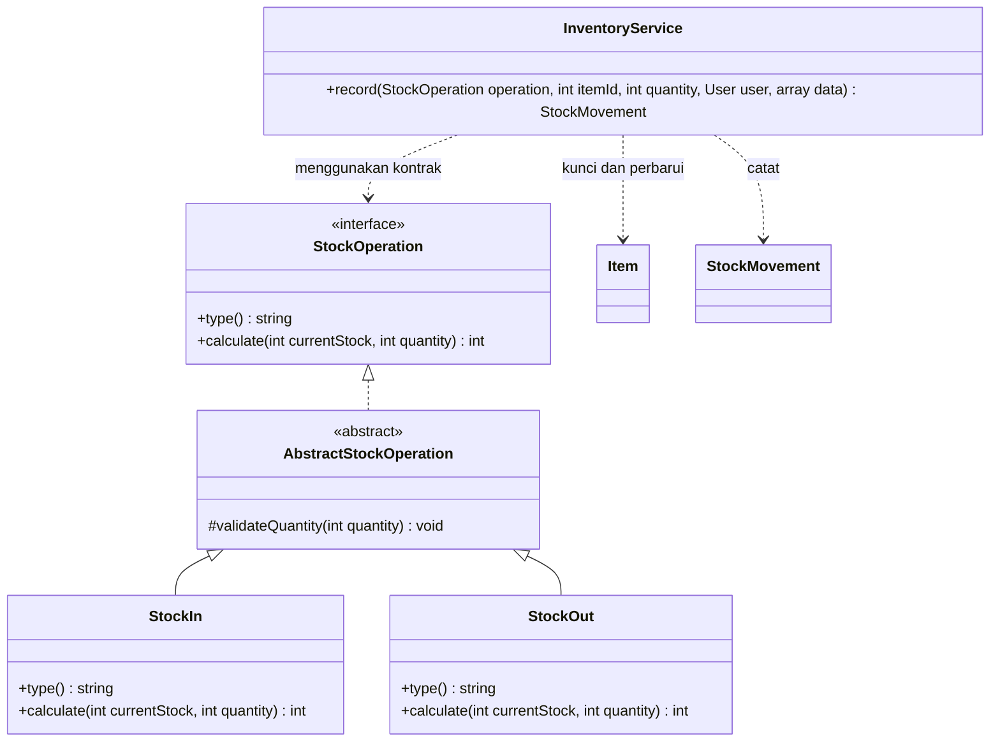
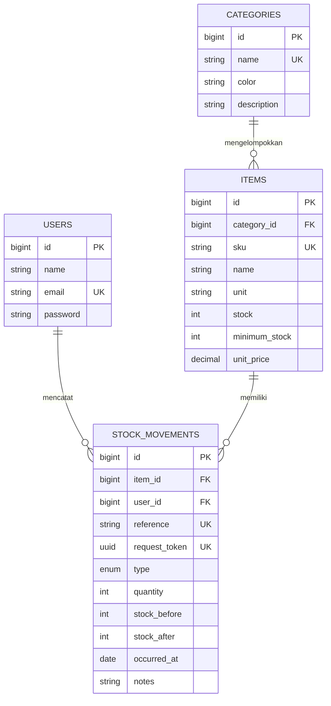

# Dokumentasi teknis dan pemetaan asesmen Stokara

## Spesifikasi dan arsitektur

Sistem mencatat persediaan ATK satu gudang: data kategori, barang, penerimaan, pengeluaran, dan riwayat. Laravel menangani request melalui route → controller → FormRequest → InventoryService → operasi stok → Eloquent/MySQL. Blade menyajikan hasil; JavaScript hanya memberikan pratinjau, sedangkan validasi penentu tetap berada di server.

## Class diagram



- **Class/method:** model Item, Category, StockMovement dan operasi calculate/record.
- **Encapsulation:** validasi jumlah bersama `protected`; implementasi internal controller `private`; operasi aplikasi `public`.
- **Inheritance:** StockIn dan StockOut mewarisi AbstractStockOperation.
- **Interface:** StockOperation menetapkan type dan calculate.
- **Polymorphism:** InventoryService menerima StockOperation; StockIn menambah, StockOut mengurangi setelah memeriksa stok.
- **Overriding:** implementasi kedua operasi memenuhi method kontrak dengan perilaku masing-masing.
- **Overloading PHP:** akses `$item->stock_status` melalui `Model::__get()` merupakan property overloading; accessor `getStockStatusAttribute()` menyediakan hasil turunan. PHP tidak mendeklarasikan dua method bernama sama berdasarkan perbedaan signature seperti Java. Bedakan dari overriding dan parameter opsional.
- **Tipe data/struktur kontrol:** integer quantity/stock, string jenis, return type, percabangan validasi, perulangan grafik dan riwayat.
- **Package:** namespace App\Contracts, App\Services\Stock, App\Models dan autoload PSR-4.
- **Sintaks:** `php artisan view:cache` disertai pemeriksaan PHP hasil kompilasi melalui `php scripts/check-syntax.php`.

## Algoritma transaksi

1. Validasi pengguna, item, jenis, UUID, jumlah bulat positif, tanggal, dan keterangan.
2. Mulai transaksi database.
3. Ambil barang menggunakan `SELECT ... FOR UPDATE`.
4. Tolak request_token yang sudah pernah dicatat.
5. Jalankan `operation.calculate(stokSekarang, jumlah)`.
6. Tolak stok keluar melebihi persediaan dan stok masuk melewati batas kapasitas aplikasi.
7. Simpan stok baru dan satu riwayat, berisi nilai sebelum/sesudah serta petugas.
8. Commit; jika gagal, rollback seluruh perubahan. Deadlock dapat dicoba ulang maksimal tiga kali oleh transaksi Laravel.

Contoh: awal 20, masuk 5 → 25; awal 20, keluar 5 → 15. Dari stok 10, dua pengeluaran bersamaan masing-masing 7 menghasilkan satu sukses, satu ditolak, stok akhir 3. Bukti aktual: `concurrency-results.json`.

## ERD



Stok awal nol; data master tidak menerima perubahan stock dari request. Foreign key memakai RESTRICT. Barang yang pernah mempunyai riwayat tidak dapat dihapus lewat aplikasi, termasuk ketika stok kembali nol. Riwayat tidak menyediakan edit/hapus pada route aplikasi.

## Library dan komponen reuse

| Komponen | Penggunaan | Bukti integrasi dan alasan |
|---|---|---|
| Laravel/Eloquent, MIT | MVC, validasi, session, ORM, transaksi | Controller, FormRequest, model, migrations; memakai fasilitas framework yang sudah terintegrasi |
| Carbon, MIT | Tanggal, periode, selisih hari, lokalisasi grafik | DashboardController dan format tanggal pada Blade; sudah menjadi dependensi Laravel |
| Bootstrap, MIT | Grid, modal kategori, dropdown akun, pagination | Aset tersalin ke public/vendor/bootstrap; tidak bergantung CDN |
| PHPUnit, BSD-3-Clause | Pengujian fungsi dan aturan stok | tests/Feature dan tests/Unit; dependensi pengembangan |
| Playwright, Apache-2.0 | QA interaksi browser | tests/browser/smoke.mjs; dependensi pengembangan |

Versi yang benar-benar terpasang: `composer.lock` dan `package-lock.json`. Inventaris lisensi Composer: `library-licenses.json`. Lisensi Bootstrap ikut disalin bersama asetnya. Pertahankan pemberitahuan lisensi saat mendistribusikan komponen.

**Efisiensi reuse:** bandingkan pekerjaan validasi, query parameter binding, session, manipulasi tanggal, modal, dan grid yang tidak perlu ditulis ulang. Catat waktu implementasi jika mengukur penghematan; proyek ini tidak mengklaim persentase penghematan waktu yang belum diukur. Reuse tetap mempunyai biaya penyesuaian, pemahaman API, dan pembaruan.

**Pengelolaan dependensi:** commit lockfiles, gunakan `composer install`/`npm ci` untuk versi yang konsisten, periksa kompatibilitas PHP dan dependensi transitif, audit lisensi/keamanan, lalu lakukan update terbatas dan pengujian pada salinan pengembangan. Jangan menjalankan update besar sesaat sebelum presentasi.

## Query, indeks, dan kinerja

Contoh query riwayat:

```sql
SELECT id, item_id, quantity, occurred_at
FROM stock_movements
WHERE type = 'out'
  AND occurred_at BETWEEN '2026-11-01' AND '2026-11-04'
ORDER BY id DESC
LIMIT 12;
```

Indeks: `(type, occurred_at)` untuk filter jenis/tanggal; `(item_id, occurred_at)` untuk riwayat barang; indeks tanggal untuk filter lintas jenis; SKU dan reference unik. Eager loading memuat item, kategori, dan petugas tanpa satu query per baris. Pagination membatasi data yang dirender. Pencarian substring `%kata%` tidak otomatis dipercepat indeks B-tree; evaluasi prefix atau FULLTEXT jika kebutuhan pencarian membesar.

`php scripts/benchmark.php` menguji agregasi dengan filter jenis dan rentang tiga hari pada 20.000 data sintetis. Baseline `USE INDEX ()` sengaja memaksa full scan; query pembanding mengizinkan optimizer memilih indeks. Hasil di `performance-results.json` mencatat median tujuh putaran setelah warmup, rencana akses, indeks terpilih, dan estimasi baris. Itu demonstrasi lokal pengaruh indeks, bukan pengukuran sebelum/sesudah migration atau jaminan waktu produksi. Semua data sintetis di-rollback.

## Koneksi, keamanan, dan hak akses

- MySQL Laragon via PDO MySQL, host 127.0.0.1 port 3306; environment tidak disimpan ke Git.
- Akun web hanya SELECT/INSERT/UPDATE/DELETE pada database stokara. Migration memakai akun administratif melalui helper lokal.
- Akun pengujian terpisah hanya pada stokara_testing. Uji integrasi menolak database selain nama tersebut.
- Password menggunakan hashing Laravel. Login membatasi percobaan dan meregenerasi session; logout menghapus session.
- Route data memerlukan autentikasi. Semua petugas memiliki hak aplikasi yang sama sesuai ruang lingkup satu peran.
- Form memakai CSRF; Blade meng-escape output; input divalidasi; Eloquent menggunakan parameter binding.
- Ekspor menetralkan awalan formula spreadsheet. Stok dan audit history disimpan dalam satu transaksi dengan row lock.

## Pertanyaan lisan dari dokumen

1. **Hasil polymorphism salah:** reproduksi kasus, periksa implementasi kontrak/override, objek operasi yang dipilih, parameter, dan pemanggilan; perbaiki akar masalah lalu uji kasus masuk, keluar, stok habis, serta jumlah tidak valid.
2. **Komponen dipakai di aplikasi lain:** periksa kontrak, asumsi, dependensi, lisensi, konfigurasi, efisiensi, dan test. StockOperation tidak mengetahui HTML/controller, tetapi batas MAX_STOCK dan ValidationException Laravel tetap perlu dievaluasi jika dipindah ke framework lain.
3. **Query melambat:** ukur query dan jumlah panggilan, gunakan EXPLAIN, periksa N+1, selektivitas indeks, volume hasil, dan pagination; bandingkan hasil pengukuran setelah perbaikan.
4. **Konflik library setelah update:** baca error dan pohon dependensi (`composer why`, `why-not`), periksa versi/PHP, tentukan kombinasi kompatibel; bila perlu pulihkan lockfile dari versi yang sudah diuji, pasang ulang dependensi sesuai lockfile, lalu jalankan tes.
5. **Database diganti:** periksa driver dan dukungan framework, koneksi, kredensial/hak akses, migration, enum, perilaku locking/transaksi, sintaks query, serta perbedaan tipe/collation. ORM membantu, tetapi perpindahan tidak cukup hanya mengganti DB_CONNECTION. Jalankan ulang CRUD, constraint, transaksi, dan kinerja.

## Manual resmi

- Laravel: https://laravel.com/docs/13.x
- PHP OOP/overloading: https://www.php.net/manual/en/language.oop5.overloading.php
- MySQL 8.4: https://dev.mysql.com/doc/refman/8.4/en/
- Composer: https://getcomposer.org/doc/
- Bootstrap: https://getbootstrap.com/docs/5.3/
- Carbon: https://carbon.nesbot.com/docs/